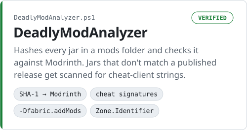
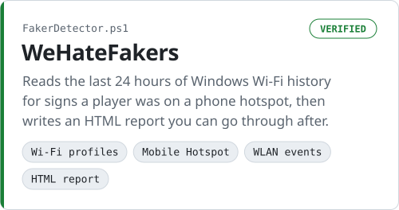

<picture>
  <source media="(prefers-color-scheme: dark)" srcset="assets/hero-dark.svg">
  <source media="(prefers-color-scheme: light)" srcset="assets/hero-light.svg">
  
</picture>

I'm Deadly. I write small PowerShell tools for Minecraft server staff. You run them on a player's PC during a screenshare and they show you what the client is really loading.

&nbsp;

### Tools

<p>
  <a href="https://github.com/LastArk123/DeadlyModAnalyzer"><picture>
    <source media="(prefers-color-scheme: dark)" srcset="assets/card-modanalyzer-dark.svg">
    <source media="(prefers-color-scheme: light)" srcset="assets/card-modanalyzer-light.svg">
    
  </picture></a>
  <a href="https://github.com/LastArk123/WeHateFakers"><picture>
    <source media="(prefers-color-scheme: dark)" srcset="assets/card-wehatefakers-dark.svg">
    <source media="(prefers-color-scheme: light)" srcset="assets/card-wehatefakers-light.svg">
    
  </picture></a>
</p>

Both are one Windows PowerShell file each, with nothing to install:

```powershell
powershell -ExecutionPolicy Bypass -File .\DeadlyModAnalyzer.ps1
```

A flagged result is a lead to look into, not proof. Each README explains what can trigger a false positive.

&nbsp;

### Next

[DeadlyDDFinder](https://github.com/LastArk123/DeadlyDDFinder) is still empty. The next tool will go there.

&nbsp;

### Credits

I'm an introvert and I build with AI help. Both tools grew out of other people's work: DeadlyModAnalyzer builds on scripts by Hadron, TonyNoh and YarpLetapStan, and WeHateFakers is credited to lily. The full credits are in each repo.
