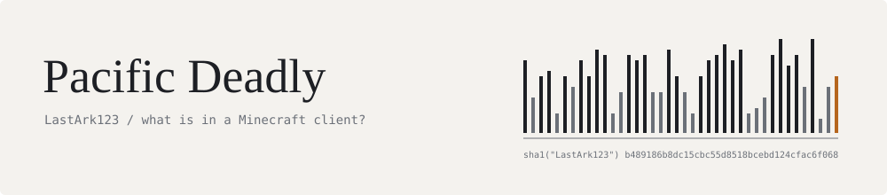

<picture>
  <source media="(prefers-color-scheme: dark)" srcset="assets/banner-dark.svg">
  <source media="(prefers-color-scheme: light)" srcset="assets/banner-light.svg">
  
</picture>

I'm Deadly. I write small PowerShell tools for Minecraft server staff: scripts you run on a player's PC during a screenshare to see what their client is really loading.

I'm an introvert and I build with AI help. The tools are things I needed, so I kept them.

&nbsp;

### What I've built

**[DeadlyModAnalyzer](https://github.com/LastArk123/DeadlyModAnalyzer)**
Reads a `mods` folder, hashes every jar and checks it against Modrinth. A jar that matches its published release is marked verified. A jar that doesn't gets scanned for known cheat-client signatures. It also checks whether the running game was launched with `-Dfabric.addMods`, which loads mods from outside the folder you're looking at.

**[WeHateFakers](https://github.com/LastArk123/WeHateFakers)**
Looks through the last 24 hours of Wi-Fi history for signs that a player was on a phone hotspot, built to catch fakers. Writes an HTML report.

&nbsp;

### Working notes

Both are Windows PowerShell, single files, no install: run the script, read the output. Both are built on other people's earlier work and say so in their READMEs.

[DeadlyDDFinder](https://github.com/LastArk123/DeadlyDDFinder) is an empty repo for the next one.

&nbsp;

Nothing else is public yet. When there is, it'll go above this line.
