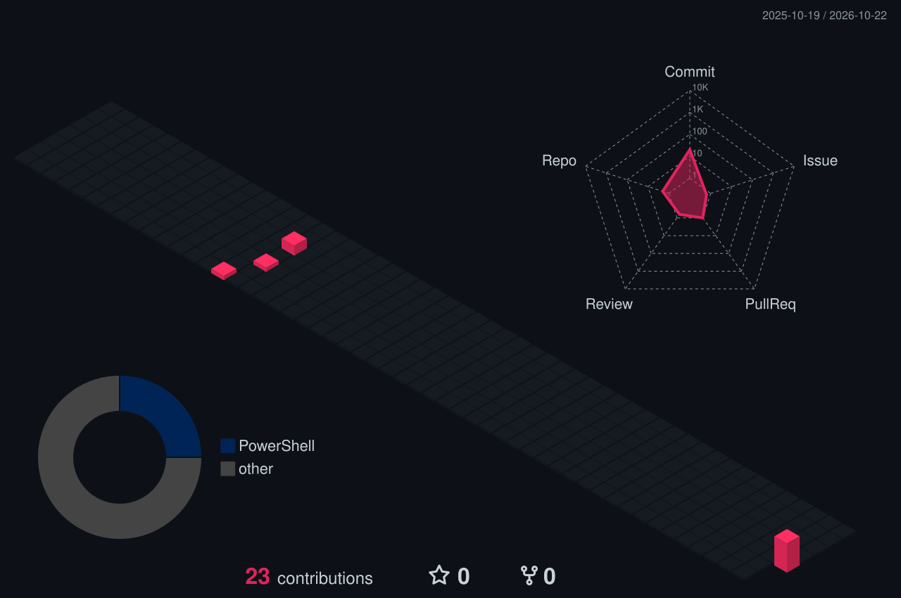

**Quiet keyboard, loud commits.**

> *"Less talking, more shipping."*

---

<h2 align="center">🩸 About Me</h2>

I'm **Sarthak Kashyap**, aka **Deadly**. An introvert who'd rather let the code do the talking. I like building small tools, automating boring stuff and figuring out how things work under the hood.

- 🔭 **Currently working on** scripts and tools that save me time
- 🌱 **Currently exploring** new languages and whatever the next project needs
- ⚙️ **I care about** code that's simple, fast and actually works
- 🧪 **Always** vibe coding, breaking things and figuring out why they broke
- 💬 **Ask me about** PowerShell, scripting and Windows automation

---

<h2 align="center">🛠️ I Code With</h2>

  

---

<h2 align="center">✨ Fun Facts</h2>

| |
|:--|
| 🌙 My best code happens somewhere between midnight and 4 AM |
| 🤫 I'll explain my code to a rubber duck before I'll explain it to a person |
| 🧩 Every "quick script" I write ends up 500 lines long |
| 🔨 I break things on purpose. It's the fastest way to learn how they work |
| 🎧 Music is always on while I code |

---

<h2 align="center">🔥 Contribution Streak</h2>

  

---

<h2 align="center">🌆 Contribution City</h2>

  

  Rebuilt twice a day by <a href="https://github.com/LastArk123/LastArk123/actions">GitHub Actions</a>

---

<h2 align="center">🤝 Let's Connect</h2>

  
  

   
  <b>Discord: deadly7.0_</b> 
  Found an issue in one of my projects? Hit me up on Discord.

---

> *"Make it work, make it right, make it fast."* — Kent Beck

Thanks for stopping by ✌️

